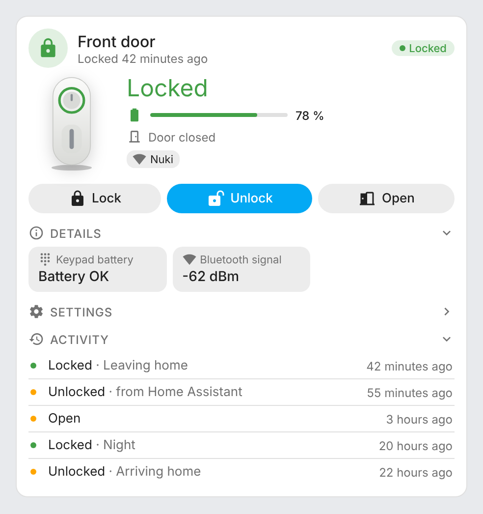
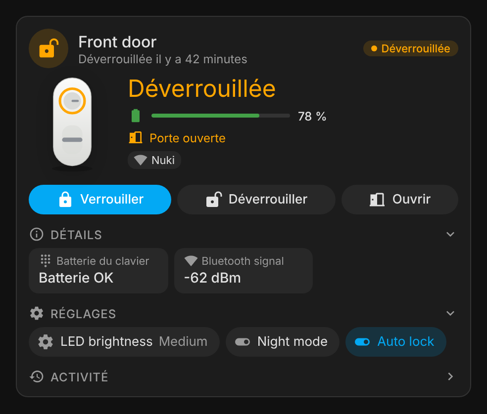
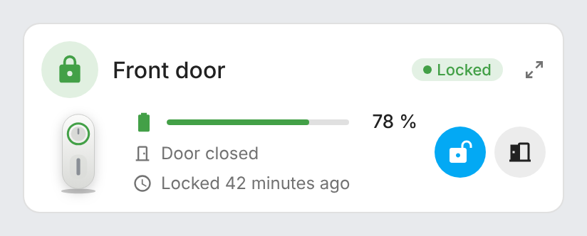
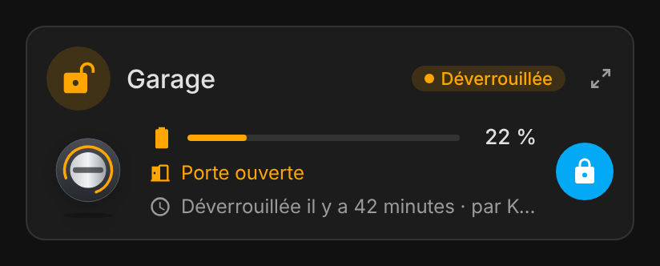
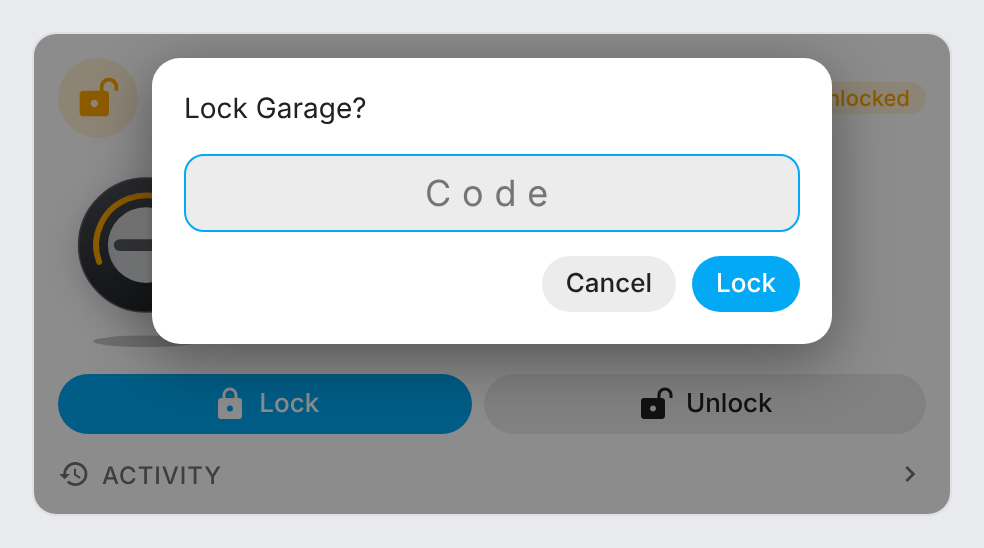
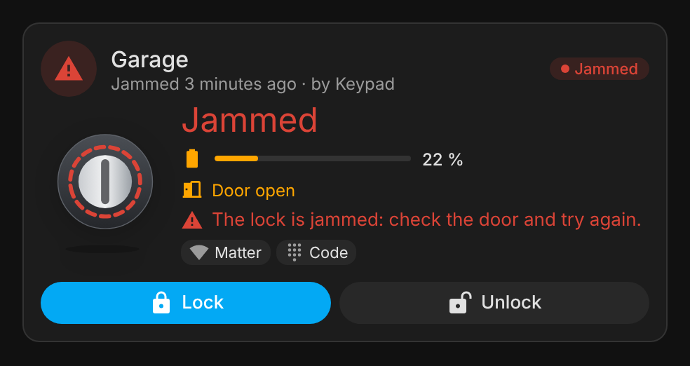
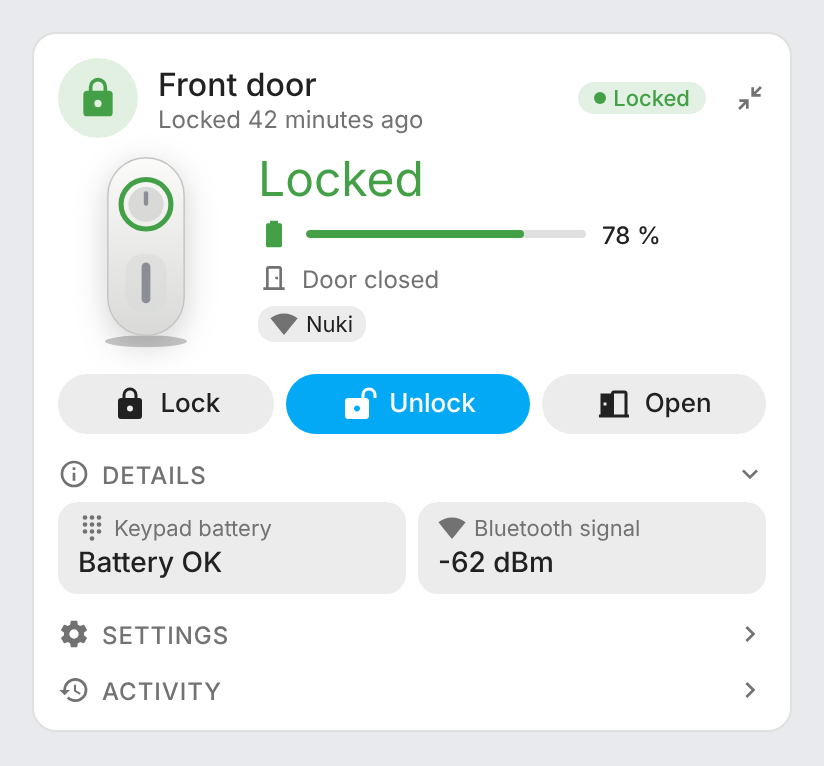

# ha-smartlock-card

[](https://github.com/hacs/integration)
[](https://github.com/juju35/ha-smartlock-card/actions/workflows/hacs.yml)
[](https://github.com/juju35/ha-smartlock-card/actions/workflows/validate.yml)
[](https://github.com/juju35/ha-smartlock-card/releases/latest)
[](LICENSE)

<p align="center"></p>

Lovelace cards for Home Assistant to monitor and control smart locks: state, door, battery, lock / unlock / open, settings and activity at a glance.

The cards work with **any lock entity**, whatever the integration: Nuki, Tedee, Yale, August, Schlage, SwitchBot, Aqara, Ultraloq, LOQED, igloohome, Sesame, UniFi Access, Matter, Z-Wave, Zigbee (ZHA, Zigbee2MQTT), HomeKit, template locks… The door sensor, battery, keypad and settings of the lock are **discovered automatically** from the Home Assistant registries, and it works whatever your Home Assistant language.

[](https://my.home-assistant.io/redirect/hacs_repository/?owner=juju35&repository=ha-smartlock-card&category=plugin)

| Smart Lock Card | Smart Lock Mini Card |
|---|---|
|  |  |

## Features

- Two cards: a full **Smart Lock Card** and a compact **Smart Lock Mini Card**
- Works with every lock integration of Home Assistant (the standard `lock` entity)
- Drawn lock picture that follows the model: retrofit, rotary knob, compact cylinder, keypad deadbolt, fingerprint lever, access reader or padlock, in white, black or steel; or a picture of your own
- The picture follows the state: locked, unlocked, open, jammed, animated while locking, unlocking or opening
- Lock, Unlock and Open buttons; Open (pull the latch) only for locks that support it
- Confirmation popup at the top of the card before unlocking and opening (configurable, also for locking)
- Code entry when the lock asks for one (`code_format`), checked against the lock's format; the code is never stored
- Automatic discovery of the entities of the lock device: door sensor, battery (percentage or "battery low"), charging, keypad battery, problem sensor
- Door open / closed, jammed lock and problem alerts
- Last change ("Locked 5 minutes ago · by Keypad" when the integration reports who)
- Details: the other sensors of the lock (signal strength, firmware…)
- Settings: switches toggle in place (auto-lock, night mode…), buttons ask before being pressed, selects and numbers open their dialog
- Activity: the last lock / unlock / open events of the logbook (7 days), with the automation or Home Assistant as the source
- Collapsible sections (settings and activity folded by default)
- Detail button on the mini card (top right): it switches the mini card to the full card's content and back; a click anywhere outside the card brings the compact view back
- Click any value to open its Home Assistant history (more-info dialog)
- Visual editor in the dashboard UI for both cards (no YAML needed)
- Light and dark mode, English and French
- Single file, no external dependency

## Prerequisites

A lock integration with at least one `lock.*` entity, with Home Assistant 2024.8 or later.

## Installation

### Via HACS (recommended)

Click the button below to add the repository directly:

[](https://my.home-assistant.io/redirect/hacs_repository/?owner=juju35&repository=ha-smartlock-card&category=plugin)

Then click **Download**, and reload your browser when HACS asks you to.

Or manually:

1. Open HACS → **⋮** (top right) → **Custom repositories**
2. Add `https://github.com/juju35/ha-smartlock-card` — Type: **Dashboard**
3. Search for **Smart Lock Card** and click **Download**
4. Clear your browser cache and refresh

### Manual

1. Download `smartlock-card.js` from the [latest release](https://github.com/juju35/ha-smartlock-card/releases/latest)
2. Copy it to `/config/www/smartlock-card.js`
3. Go to **Settings → Dashboards → ⋮ → Resources** → Add resource:
   - URL: `/local/smartlock-card.js`
   - Type: **JavaScript Module**
4. Clear your browser cache and refresh

## Configuration

### Visual editor

Edit a dashboard, click **Add card** and search for **Smart Lock Card** or **Smart Lock Mini Card**. The first lock is preselected; pick another one if you have several, set an optional title, choose the buttons, the confirmations, the sections to display and the language. The preview updates live, and options left at their default are kept out of the generated YAML.

### Minimal

```yaml
type: custom:smartlock-card
```

```yaml
type: custom:smartlock-mini-card
```

### Full options

```yaml
type: custom:smartlock-card
entity: lock.front_door
title: Front door
image: auto
finish: white
show_icon: true
show_picture: true
show_controls: true
show_open: true
show_details: true
show_settings: true
show_activity: true
confirm:
  - unlock
  - open
collapsed:
  - settings
  - activity
door_entity: binary_sensor.front_door_contact
battery_entity: sensor.front_door_battery
language: fr
```

```yaml
type: custom:smartlock-mini-card
entity: lock.garage
title: Garage
image: knob
show_icon: true
show_picture: true
show_controls: true
show_open: true
confirm:
  - unlock
  - open
zoom: true
language: fr
```

### Options reference

| Option | Card | Default | Description |
|---|---|---|---|
| `entity` | both | First lock | Lock entity (`lock.*`) |
| `title` | both | Lock name | Card title |
| `image` | both | `auto` | Lock picture: `auto` (per model), `retrofit`, `knob`, `compact`, `keypad`, `lever`, `reader`, `padlock`, `none`, or the URL of your own picture (e.g. `/local/my-lock.png`) |
| `finish` | both | Per model | Finish of the drawn picture: `white`, `black` or `steel` |
| `show_icon` | both | `true` | State icon at the left of the header |
| `show_picture` | both | `true` | Lock picture (same as `image: none` when `false`) |
| `show_controls` | both | `true` | Lock / Unlock buttons (a single toggle button on the mini card) |
| `show_open` | both | `true` | Open button, for locks that can pull the latch (Nuki, Tedee, Matter…) |
| `confirm` | both | `[unlock, open]` | Actions that ask for confirmation, among `lock`, `unlock` and `open` (`[]` to never ask). A lock that needs a code always asks for it |
| `code` | both | — | Code sent with every action, for locks that need one and when you don't want to type it. It is stored in the dashboard configuration in clear text: prefer typing it |
| `door_entity` | both | Found on the lock device | Door sensor (`binary_sensor`), when it belongs to another device (a contact sensor on the door) |
| `battery_entity` | both | Found on the lock device | Battery: a percentage `sensor`, or a "battery low" `binary_sensor` |
| `zoom` | mini | `true` | Detail button at the top right of the mini card: it shows the full card's content (with the same options, so `show_settings`, `collapsed`… can be set on the mini card too) and switches back to the compact view; a click outside the card also brings the compact view back. `false` removes the button |
| `show_details` | full | `true` | Other sensors of the lock device (keypad battery, signal strength…) |
| `show_settings` | full | `true` | Switches, selects, numbers and buttons of the lock device |
| `show_activity` | full | `true` | Last events of the lock in the logbook |
| `collapsed` | full | `[settings, activity]` | Sections folded by default, among `details`, `settings` and `activity` (`[]` to unfold everything). Click a section title to fold or unfold it |
| `language` | both | Auto | Force language: `fr` or `en` (auto-detects from HA settings) |

## Screenshots

| Light | Dark (French, unlocked, door open) |
|---|---|
|  |  |
|  |  |

Lock asking for a code, and jammed lock:

| Code | Jammed |
|---|---|
|  |  |

Mini card zoomed in with its detail button (top right, click it again or anywhere outside the card to go back):



## How it works

The cards use the standard `lock` entity, so every lock integration works: the state (`locked`, `unlocked`, `open`, `locking`, `unlocking`, `opening`, `jammed`), the `lock.lock`, `lock.unlock` and `lock.open` actions, the Open feature (`supported_features`), the `code_format` and `changed_by` attributes.

The other entities of the lock are found through the entity and device registries: everything on the same device as the lock, matched by its domain and device class (`door` / `opening` / `garage_door` for the door, `battery`, `battery_charging`, `problem`), the keypad by its name. Entity ids can therefore be in any language or renamed without breaking the cards. When the door sensor or the battery belongs to another device, set `door_entity` or `battery_entity`.

<p align="center"></p>

The picture is drawn for the family of the lock, picked from its integration, manufacturer, model and name: retrofit case (Nuki Smart Lock 3/4/5, SwitchBot Lock), rotary knob (Tedee Pro, Yale Linus, Sesame, Aqara U100/U200, August), compact cylinder (Nuki Smart Lock Ultra, Tedee GO), keypad deadbolt (Yale Assure, Schlage, Kwikset, Ultraloq U-Bolt), fingerprint lever (Ultraloq Latch, Aqara D100/A100, LOQED), access reader (UniFi Access, ekey, KIWI) and padlock for anything else. These are generic drawings of each kind of lock, not pictures of the products. Use `image` and `finish` to pick another one, or your own picture.

The picture follows the lock state: the thumb turn or knob turns (the lever dips, the shackle lifts) when unlocked, moves while locking or unlocking, waves while opening, shakes when jammed, and the light takes the state color. It stays still with the reduced-motion setting.

After a button press, the card shows the requested state (Locking…, Unlocking…, Opening…) until the lock reports a new one (20 s at most); if the call fails (wrong code, lock offline), the real state is shown again and Home Assistant reports the error.

The activity section reads the logbook (`logbook/get_events`) when it is unfolded, and again when the lock changes. The source of each event is the automation or script that triggered it, or "from Home Assistant" for an action from the interface.

## Development

```bash
npm install
npm run build        # bundles src/smartlock-card.js into dist/smartlock-card.js
npm run check        # builds and checks the card (run in CI)
npm test             # unit tests (node --test, no browser)
npm run screenshots  # renders the cards with mock data (scripts/mock-states.mjs) into screenshots/
```

`dist/` is not committed: `npm run build` creates it locally, CI builds it on every push, and the release workflow attaches the built file to the release, which is where HACS downloads it from.

### Releasing

1. Bump `version` in `package.json`
2. Add a `## <version>` section at the top of [CHANGELOG.md](CHANGELOG.md)
3. Push to `main`: the **Release** workflow builds the card, creates the tag and the GitHub release with the changelog section as notes, and attaches `smartlock-card.js`

## Translations

The cards auto-detect the language from your Home Assistant settings. Currently supported:

| Language | Code |
|---|---|
| English | `en` |
| Français | `fr` |

Contributions for additional languages are welcome!

## Credits

Lock brands and logos are trademarks of their respective owners. This project is not affiliated with any of them.

## License

[MIT](LICENSE)
